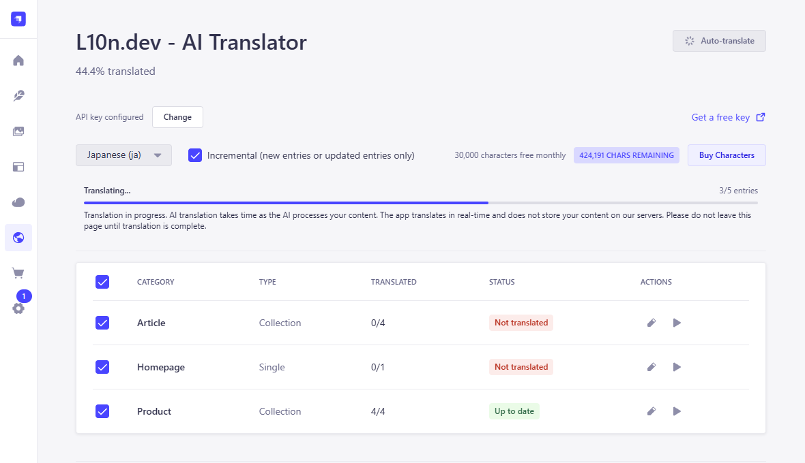
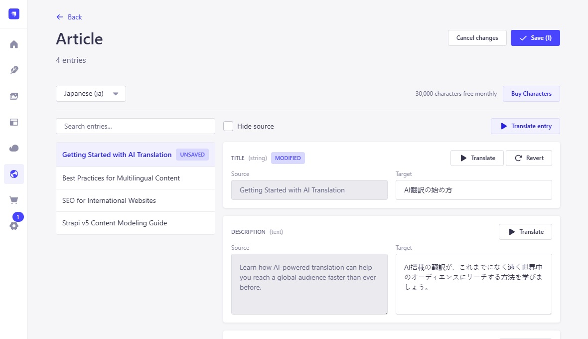

# Strapi Plugin - AI Translator (l10n.dev)

[](https://www.npmjs.com/package/strapi-plugin-ai-translator)
[](https://opensource.org/licenses/MIT)

Translate your Strapi v5 i18n content with l10n.dev [AI localization](https://l10n.dev) service - directly from the Admin Panel. Supports bulk auto translation, per-field translation, and a side-by-side editor for reviewing and editing results. The AI engine understands context, supports 165 languages, preserves formatting and structure, and follows grammar and plural form rules - producing natural, human-like translations.

**10,000 characters free every month** - no credit card required.

---

## Features

- **Main Dashboard** — See all your i18n-enabled Content Types at a glance with translation progress per target language.
- **Bulk Auto-translate** — Select multiple Content Types and translate them all with one click. Parallel processing with real-time progress bar.
- **Translate button in Content Manager** — A "Translate from {language}" button appears directly in the entry edit panel when you switch to a non-default locale. Translate the current entry without leaving the Content Manager.
- **Side-by-Side Editor** — Click "Edit" on any Content Type to open a split view: read-only source on the left, editable target on the right. Translate, revert, or manually edit per field.
- **Per-field Translate** — Translate individual fields without touching the rest.
- **Incremental Mode** — Only translate new/changed entries, saving your character quota.
- **Usage Tracking** — Monitor usage and remaining balance.
- **Persistent Preferences** — Selected target language, incremental toggle, and category selections are saved across sessions.
- **Localized UI** — The plugin interface is available in 11 languages. It follows the language you select in your Strapi profile.
- **Translation Glossary** - Generate and save AI glossaries for consistent terminology across translations.

---

## Screenshots

| Dashboard | Side-by-Side Editor |
|-----------|-------------------|
|  |  |

---

## Installation

### 1. Install the package

```bash
npm install strapi-plugin-ai-translator
# or
yarn add strapi-plugin-ai-translator
```

### 2. Enable the plugin

Add to your Strapi project's `config/plugins.ts` (or `config/plugins.js`):

**TypeScript** (`config/plugins.ts`):
```ts
export default () => ({
  'ai-translator': {
    enabled: true,
  },
});
```

**JavaScript** (`config/plugins.js`):
```js
'use strict';

module.exports = () => ({
  'ai-translator': {
    enabled: true,
  },
});
```

### 3. Rebuild and start

```bash
npm run build
npm run develop
```

---

## Configuration

### Get your API Key

1. Go to [l10n.dev/ws/keys](https://l10n.dev/ws/keys) and create a free API key.
2. Open the Strapi Admin Panel and navigate to **L10n.dev - AI Translator** in the sidebar.
3. You will see a **"Paste your l10n.dev API key to start translating"** input at the top of the page.
4. Paste your key into the field and click **"Save"**.
5. The plugin is ready to use.

> To update the key later, find the **"API key configured"** label at the top of the dashboard and click **"Change"**.

### Plugin Settings (stored in Strapi)

| Setting | Description | Default |
|---------|-------------|---------|
| `apiKey` | Your l10n.dev API key | _(empty)_ |
| `incremental` | Only translate new/changed entries | `true` |
| `lastTargetLocale` | Remembers your last selected target language | _(auto)_ |
| `selectedCategories` | Remembers which Content Types are checked for bulk translate | `[]` |

All settings are managed through the Admin Panel UI — no file-based configuration needed.

---

## Usage

### Prerequisites

- **Strapi i18n plugin** must be enabled (ships with Strapi by default).
- At least **two locales** must be configured in Settings → Internationalization.
- Content Types you want to translate must have **"Enable localization for this content-type"** turned on, with individual fields marked as localizable.

> **Important — per-field localization required.** Each field you want translated must have `"pluginOptions": { "i18n": { "localized": true } }` set in its schema. Without this, Strapi treats the field as shared across all locales — saving a translation would overwrite the source locale. When you enable localization for a Content Type through the Content-Type Builder UI, this is set automatically. If you edit schemas manually or use a Strapi CLI-generated project, verify each translatable field is marked accordingly. See the [Strapi i18n documentation](https://docs.strapi.io/cms/features/internationalization) for details.

### Dashboard

1. Open **L10n.dev - AI Translator** from the sidebar.
2. Select your **target language** from the dropdown.
3. The table shows all i18n-enabled Content Types with their translation status (e.g., "17/17", "0/39").
4. Check the boxes for the Content Types you want to translate, then click **"Auto-translate"**.
5. A progress bar shows real-time translation status.

### Translate from Content Manager

1. Open any i18n-enabled Content Type entry in the **Content Manager**.
2. Switch to a **non-default locale** using the locale picker in the top-right.
3. A **"Translate from {language}"** button appears in the right panel (e.g. "Translate from English").
4. Click it — all localizable fields are translated.
5. Review and save when ready.

> The button is hidden when you are already viewing the default locale.

### Side-by-Side Editor

1. Click **"Edit"** (pencil icon) on any Content Type row.
2. Browse entries in the left sidebar; select one to see its fields.
3. Each field shows the source text (read-only) on the left and the editable target on the right.
4. Use **"Translate"** to AI-translate a single field, or **"Revert"** to undo changes.
5. Click **"Save"** to persist all changes back to Strapi.

### Incremental Mode

When enabled, entries that are already up-to-date are skipped entirely, saving your character quota. Strapi does not track which specific field changed so we store hash of the source text (not content itself) for comparison of text changes new hash insects the text should be retranslated. To translate or edit a single field independently, open the entry in the [Editor](#side-by-side-editor).

## Translation Glossary

A translation glossary maps specific source-language terms to approved target-language equivalents, ensuring the AI uses your exact terminology instead of valid-but-unintended synonyms. Glossaries are especially valuable for brand names, legal terms, clinical vocabulary, and product-specific concepts.

### AI Glossary Generation

When **Generate & Save Glossary** is enabled (config) it automatically builds a glossary from the source and translated target content, then save it as the active glossary for this source/target language pair. Once saved, the glossary is applied automatically on all future translations for the same language pair.

> **Note:** When **Generate & Save Glossary** is enabled, your character quota is debited for the full source content upfront — even when you choose translating only new strings, because AI analyze whole content to build correct glossary.

Manage your saved glossaries at [l10n.dev/ws/translation-glossary](https://l10n.dev/ws/translation-glossary).

---

## API Endpoints

All endpoints are admin-authenticated (`admin::isAuthenticatedAdmin`) and prefixed with `/ai-translator`.

| Method | Path | Description |
|--------|------|-------------|
| `GET` | `/settings` | Get plugin settings |
| `PUT` | `/settings` | Update plugin settings |
| `GET` | `/content-types` | List i18n Content Types with translation stats |
| `GET` | `/content-types/:uid/entries` | List entries for a Content Type |
| `GET` | `/content-types/:uid/entries/:documentId` | Get single entry with source/target fields |
| `POST` | `/translate` | Translate a single field of an entry |
| `POST` | `/translate/bulk` | Start bulk translation (auto translation) |
| `POST` | `/translate/save` | Save translated fields to Strapi |
| `GET` | `/translate/status` | Poll bulk translation progress |
| `POST` | `/translate/cancel` | Cancel a running bulk translation |

---

## Compatibility

| Dependency | Version |
|------------|---------|
| Strapi | `^5.0.0` |
| Node.js | `>=18.0.0` |
| `@strapi/design-system` | `^2.0.0` |
| `ai-l10n-core` | `^1.4.1` |

> This plugin is **Strapi v5 only**. It is not compatible with Strapi v4.

---

## How it works

1. The plugin introspects your Strapi content types at runtime to find those with i18n localization enabled.
2. For each localizable field (`string`, `text`, `richtext`, `blocks`, `email`), it extracts the source-language value and sends it to the [ai translation API](https://api.l10n.dev/doc) via the [`ai-l10n-core`](https://www.npmjs.com/package/ai-l10n-core) client library.
3. Translated fields are saved as **draft** entries in Strapi via the Document Service API. You publish them using Strapi's native publish workflow.
4. The API key and preferences are stored securely in Strapi's plugin store — never exposed to the client in full.

---

## Pricing

- **Free tier** — 10,000 characters free every month, no credit card required.
- **Pay-as-you-go** — Affordable character-based pricing with no subscription required.
- **Current rates** — Visit [l10n.dev/#pricing](https://l10n.dev/#pricing) for up-to-date pricing.

---

## Privacy & Security

- **Secure API keys** — Stored in Strapi's plugin store, never exposed to the browser in full.
- **No data retention** — Source text and translations are not stored on l10n.dev servers beyond the time needed to process the request.
- **Encrypted communication** — All API calls use HTTPS.
- **Privacy first** — Built by developers for developers, with privacy, reliability, and quality as core priorities.

---

## Support

| | |
|---|---|
| 📧 Email | [support@l10n.dev](mailto:support@l10n.dev) |
| 🐛 Issues | [GitHub Issues](https://github.com/l10n-dev/strapi-plugin-ai-translator/issues) |
| 📚 API Docs | [api.l10n.dev/doc](https://api.l10n.dev/doc) |
| 🌐 Website | [l10n](https://l10n.dev).dev |

---

## Localization

The plugin interface is translated into the following languages:

| Code | Language |
|------|----------|
| `en` | English (default) |
| `de` | German |
| `es` | Spanish |
| `fr` | French |
| `id` | Indonesian |
| `it` | Italian |
| `ja` | Japanese |
| `ko` | Korean |
| `pt` | Portuguese (Brazil) |
| `zh-CN` | Chinese (Simplified) |
| `zh-TW` | Chinese (Traditional) |

To switch the plugin UI language:

1. Click your avatar in the top-right corner of the Strapi admin panel and go to **Profile**.
2. Under **Preferences → Interface language**, select your language.
3. The plugin UI (labels, messages, notifications) will display in the chosen language immediately.

To make these languages available in the profile picker, add them to your project's `src/admin/app.js`:

```js
export default {
  config: {
    locales: ['de', 'es', 'fr', 'id', 'it', 'ja', 'ko', 'pt', 'zh-CN', 'zh-TW'],
  },
  bootstrap() {},
};
```

---

## License

[MIT](LICENSE) — see the [LICENSE](LICENSE) file for details.
